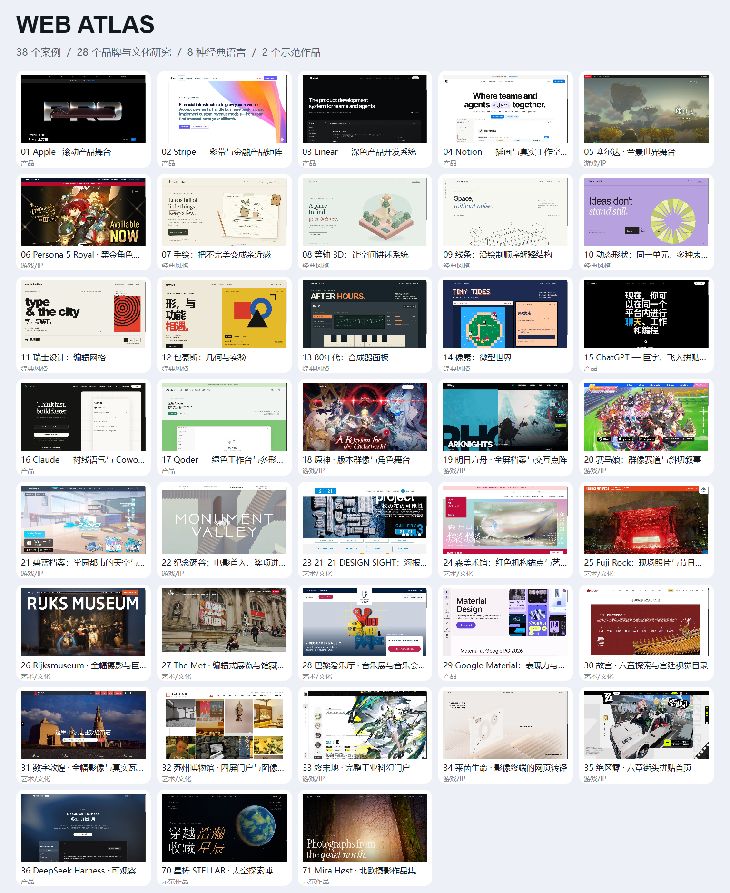

# WEB ATLAS

### 可交互 · 可查询 · 可回看的个人网页设计案例、巧思与内容素材库

从真实网站学习设计，让配色、排版、图像、形状和动效共同工作；从完整案例理解整体，把独立巧思组合成自己的设计；亲手试用组件与内容素材，再带着使用方式和授权边界取材。

<!-- atlas-counts:start -->
**38 个案例**　·　**28 个品牌／文化研究**　·　**8 种经典设计语言**　·　**2 个示范作品**
<!-- atlas-counts:end -->

[打开首页](https://mibxr-design-atlas.mibxranime.chatgpt.site) · [案例库](https://mibxr-design-atlas.mibxranime.chatgpt.site/cases.html) · [巧思库](https://mibxr-design-atlas.mibxranime.chatgpt.site/patterns.html) · [内容素材库](https://mibxr-design-atlas.mibxranime.chatgpt.site/materials.html) · [设计实验室](https://mibxr-design-atlas.mibxranime.chatgpt.site/lab.html) · [Agent 工作流](https://mibxr-design-atlas.mibxranime.chatgpt.site/agent.html) · [文档中心](https://mibxr-design-atlas.mibxranime.chatgpt.site/docs.html) · [完整索引](docs/cases/README.md)

配图来自可运行 Demo 的实际浏览器截图。

[使用指南](docs/guide.md) · [案例画廊与研究总览](docs/overview.md) · [素材使用说明](docs/materials/README.md) · [Agent 取材](docs/agent.md) · [收录与维护规范](CONTRIBUTING.md)
