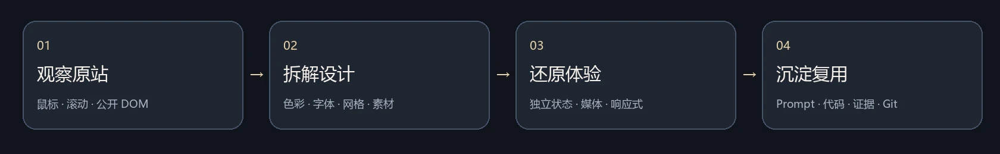
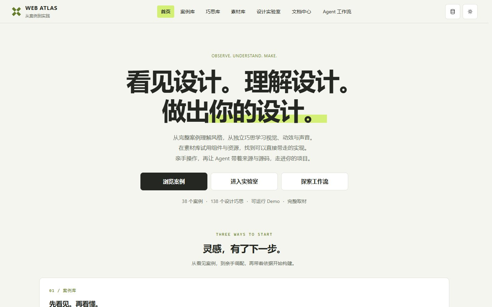
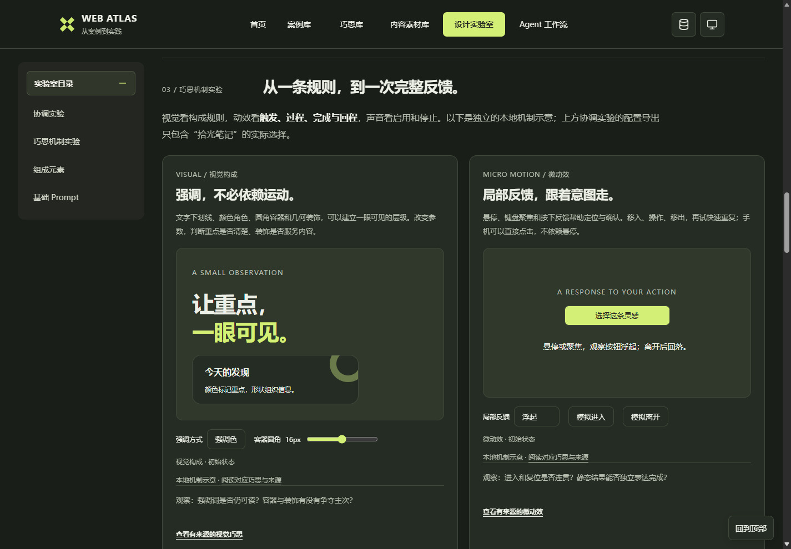
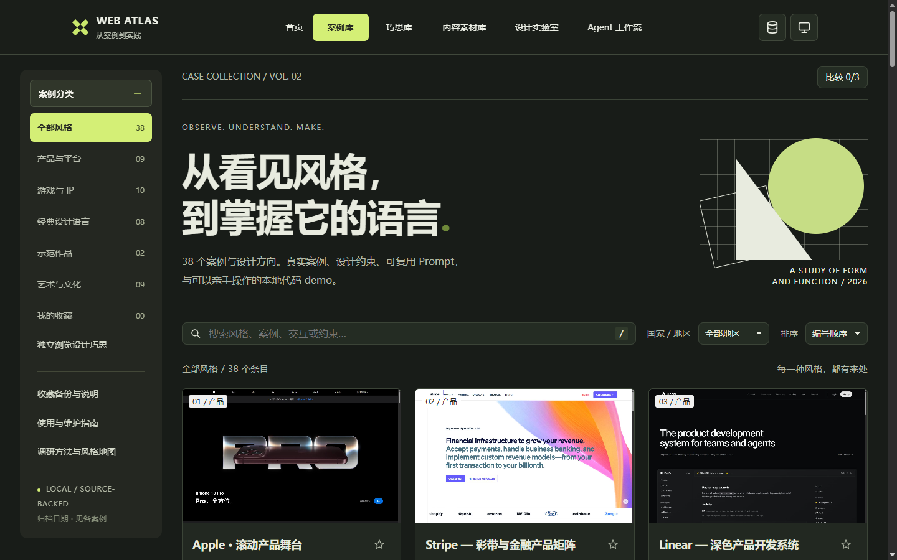

# Web Atlas 使用指南

这是一份能亲手体验的设计参考。每个条目包含实际参考与观察日期、设计元素的协作方式、约束、可复制 Prompt、独立代码 Demo、原站／本地对照及素材来源。

首页介绍完整案例、独立巧思、内容素材、设计实验室与 Agent 工作流，主导航可直接切换。案例浏览位于 `cases.html`。

真实网站案例固定为所标注网址与采集日期的单一归档；完成后保留当时的页面与交互，不追随官网后续变化。

- **查找**：按产品、游戏/IP、艺术文化、经典语言、示范作品与国家／地区筛选；搜索品牌、配色、布局、交互或约束。分类、地区、搜索与排序保留在 URL 中，支持刷新恢复、浏览器前进／后退和分享筛选结果（例如 `cases.html?category=showcases`）。
- **体验**：在详情内滚动、悬停、切换和播放，或独立打开完整 Demo；案例与巧思共用适应面板、桌面 1440px、手机 ≤390px 和重播控件，高度随可用视口调整，内容在 Demo 内滚动。
- **比较**：选择2–3项并排比较，七节说明按同名章节逐行对齐；每行采用最长内容所需的自然高度，便于比较不同案例在同一设计维度上的区别。
- **巧思库**：独立巧思页按视觉、微动效、页面动效、声音、内容与组织筛选，再按功能用途、来源案例与关键词找可单独借用的机制；首页和实验室可实际操作本地示意，巧思详情按需载入完整来源 Demo；每项有触发、结果、适用场景、边界、组合建议、Prompt和完整案例回跳。同一机制可以来自多个案例，也可以与其他案例的机制组合。
- **素材库**：在代表性样例中试用组件与资源，按类型、用途与关键词筛选；详情保留参数、安装方式、源码、Prompt、版本、来源与许可证。Google Material Web、手绘 Wired Elements、复古 98.css、Recursive 可变字体与 Shaders 提供不同的组件语言、试排与视觉效果，按需载入并保留明确的兼容性后备；完整库与作者工具回到原始仓库。
- **试验**：配色、字体、布局、留白、形状、图形、层级、质感与动效都能在设计实验室中直接改变画面；深浅主题按背景、表面、文字与强调角色一起变化，JSON和Prompt导出保留实际选择。
- **复用**：复制案例 Prompt，将品牌、内容和资产换为自己的输入；约束与负向 Prompt 一起使用。
- **Agent 选型**：调用 [web-atlas skill](https://github.com/MIBXR/mibxr-skills/tree/main/skills/web-atlas)，先了解最新目录，再围绕需求迭代筛选，自动取得完整说明、文档和源码。也可从 [Agent 入口](https://mibxr-design-atlas.mibxranime.chatgpt.site/agent.html) 直接取指定案例。
- **桌面与手机**：每个案例保留真实桌面与手机预览；手机页面目录默认收在顶栏，长页面提供浮动“回到顶部”。
- **主题与声音**：案例库支持跟随系统／浅色／深色；每个案例说明原站的主题方式、音乐或媒体声音及其交互作用，固定品牌主题保留原貌。
- **收藏**：收藏与备份见“[收藏与迁移](#收藏与迁移)”。
- **文档阅读**：文档操作见“[文档阅读](#文档阅读)”。
- **加载与复用**：案例先准备首屏关键图像、字体与视频第一帧，再开始开场；未就绪时显示进度与重试。固定版本的大素材在同一站点内缓存，嵌入预览与独立打开共享已经下载的内容。



### 本地运行

需要 **Node.js**，项目运行不需要安装第三方依赖。执行：

```bash
npm start
```

打开 [http://127.0.0.1:4173](http://127.0.0.1:4173)。`Ctrl+C` 结束服务。服务绑定本机；不同主机名或端口分别保存收藏。

### 素材来源、加载与缓存

仓库保留完整原始素材。本地运行默认 `auto`：先读自身目录，已映射的大素材加载失败时，才使用固定 Git 提交中的 GitHub 备份。在完整源码／本地构建中，独立 Demo 地址可加 `.?assets=local` 强制本地，或 `.?assets=github` 切换动态图像、视频与声音的来源；样式表中的背景和字体保留本地地址。Sites 构建会在输出时统一将对应CSS地址也改为固定GitHub地址，因此精简Sites包不支持强制本地或离线使用。来源切换不改变布局、动效或声音设计。

复用单个真实网站 Demo 时，也需携带`data/asset-sources.js`、`site/runtime/` 中的共享运行时与根目录的 `asset-cache-worker.js`，或将这些公共模块连同引用一起迁移。入口HTML是项目的一部分，直接下载一份HTML无法包含它依赖的图像、字体和脚本。

`npm run build:site` 生成引用 GitHub 大素材的部署目录，省略对应的大文件，保持素材原字节与画质。`npm run build:local` 生成包含全部素材的静态目录，可用于完整本地托管。两种构建都不修改 `demos/` 中的原始素材。GitHub 素材固定到 `data/asset-sources.js` 中的完整提交 SHA；Sites 的大素材首次下载需要网络。

首屏加载只等待当前画面必要的图片、可见字体和视频首帧，后续章节提前按需准备。进度按已就绪资源项统计，不伪造下载字节百分比；失败时可以重试或继续浏览。明日方舟与塞尔达保留自己的原站风格加载／声音入口，开场从资源就绪之后开始。音乐由用户启用，不进入首屏必等列表。

固定 GitHub 地址的大素材使用浏览器 Cache Storage 保存；后续再次进入时优先复用，完整视频缓存支持字节区间读取与拖动。嵌入预览与独立页面同属一个站点时共享这份缓存。只按访问加载，不在进入案例库时下载所有案例；素材缓存最多256MiB，按存入顺序移除较早的素材。HTML、脚本与样式照常获取当前版本。本地服务使用 ETag／Last-Modified 条件请求，未变化的本地文件返回304并复用已下载内容。

顶栏主题按钮旁的素材缓存工具可查看、清除已下载的素材。收藏与素材缓存分别保存。Cache Storage 由浏览器管理；缓存缺失时重新下载，参见 [MDN Cache](https://developer.mozilla.org/en-US/docs/Web/API/Cache)。

### 从参考到自己的设计

1. 在对应 Demo 中实际操作，读清楚原站观察与本地差异。
2. 复制 `prompts/cases/<id>.md`，填写目标产品、内容、素材、尺寸与观察日期。
3. 保留该风格的网格、层级、比例和状态关系，再调整自己的品牌输入。
4. 对照制作约束，测试滚动、键盘、手机、音视频及减少动态效果。
5. 保存对比截图、改动理由与Git提交，让个人判断也能回看。

音频由用户启用；静音视频可播放并提供暂停。真实品牌图片、字体及本地音视频按原比例保存；Apple 的完整产品影片按需播放官方在线流，需要网络。登录、购买、预约和实际服务入口指向官网，不在本库执行。

### 收藏与迁移

案例、巧思与素材收藏保存在当前站点浏览器的 `localStorage`，使用 `web-atlas-favorites` 保存三种条目的 ID，备份格式为 `{"format":"web-atlas-favorites","cases":[],"patterns":[],"materials":[]}`。

刷新保留；换浏览器、地址、端口或清理网站数据后，收藏不同。各库的“收藏备份与说明”导出同一个 JSON 文件，包含案例、巧思与素材收藏；粘贴导入时合并有效 ID、去重并忽略未知条目。将导出的 JSON 自行纳入 Git 即可保存个人策展结果。已下载的素材由顶栏缓存工具单独管理。


## 文档阅读

文档中心的左侧分类可折叠，切换文档保留目录状态和滚动位置；右侧提供本文一、二级标题，手机通过浮动按钮展开。收录范围与维护流程见 [CONTRIBUTING](../CONTRIBUTING.md#文档分工与唯一位置)。


## 网站也从自己的案例中学习

Web Atlas 也在使用自己的案例库。首页借鉴收录的 [ChatGPT 案例](../demos/cases/chatgpt-platform/fidelity.md) 的滚动交接，用同一展示窗串起浏览案例、调配元素与参考构建；实验室把案例的配色、排版与构成机制迁移到同一份内容上，让方案可以实际操作与比较。

从案例中找依据，在实际使用中观察，再结合人的反馈改进网站本体。这也是这份案例库从参考走向实践的过程。



| 首页中的真实实验室 | 案例库 |
| --- | --- |
|  |  |

以上为网站本体的实际浏览器截图；各案例的独立 Demo 预览见[案例画廊](overview.md#案例画廊)。

