# 调研方法与案例地图

采集日期按每个案例分别记录，数量与分类以自动生成的 [案例索引](cases/README.md) 为准。内容包含原站局部复现、官方视觉资料的网页转译和经典构成练习；三种范围在案例说明与复现边界中分别标注。

## 按地区研究的方法

同在日本，21_21 的设计展示、森美术馆的机构信息、Fuji Rock 的年度活动宣传以及游戏页面承担不同任务，其字体、密度、素材和交互可以非常不同。应先对照具体机构与版本，再寻找可复用机制。

跨地区比较用相同问题：文字与图像谁先出现？标题尺度与行长怎样设定？网格是否稳定？主色用于背景、品牌还是行动？预约/下载和内容怎样靠近？滚动是章节递进、连续舞台还是信息列表？声音从何处启用、能否关闭？

文化案例覆盖中国的宫殿建筑、石窟壁画与江南博物馆，以及日本、荷兰、美国、法国的展览、博物馆、音乐节与音乐会/音乐展。游戏提供中国、日本、韩国和英国的创作来源，以及地区发行版本。

详细样本比较见 [国别案例比较](country-comparison.md)，包括日本六例的视觉与交互差异。

中国文化方向可对照 [故宫](cases/palace-museum.md) 的建筑章节与文化入口、[数字敦煌](cases/digital-dunhuang.md) 的图像档案和分面检索、[苏州博物馆](cases/suzhou-museum.md) 的建筑身份与目的地目录。“古风”在这些样本中分别来自建筑部件、文物与壁画、地方空间的具体表达，不仅是配色或毛笔字。

工业科幻方向分别看 [明日方舟](cases/arknights-world.md) 的暗灰战术档案、[终末地](cases/endfield-industrial.md) 的白底黄信号与技术模块、[莱茵生命](cases/rhine-lab.md) 的官方影像档案构成。莱茵条目的网页选择／返回是教学改编；终末地采用白底亮黄工业界面，莱茵采用米白透明档案与橙色信号。

## 设计选择与约束

- 硬件：真实产品摄影、尺度与细节负责证明，不用抽象球体代替产品。
- 平台：真实软件界面、工作结果与任务流程负责解释能力。
- 游戏/IP：世界、角色、玩法与章节节奏负责建立期待。
- 艺术/文化：作品/表演本身、策展主题和参观行动形成层级；日期与地点需要可查。
- 经典方向：网格、投影、线条、形色、像素和质感是构成原则；不同项目不必共享同一布局。

实验室把设计元素做成交互控件，用来观察变量怎样协调；品牌页则保留自己的结构。设计基础来源见 [foundations.md](foundations.md)。

声音与动态的实现、观察和验收见 [维护规范](../CONTRIBUTING.md#观察与实现)。

## 案例画廊

图片进入对应在线案例，文字链接可直接阅读 Prompt、研究与代码。品牌页面按各自注明范围归档复现，官方影像条目明确标记网页转译，经典语言是有真实参考与理论依据的构成练习；示范作品归档来源仓库的固定提交，虚构人物与机构文案按示范内容阅读。

### 产品与平台 · 9

从产品卖点到可观察的工作结果，版式与交互各自承担说明任务。

<table>
<tr>
<td width="33%" valign="top"><a href="https://mibxr-design-atlas.mibxranime.chatgpt.site/cases.html#style/apple-product">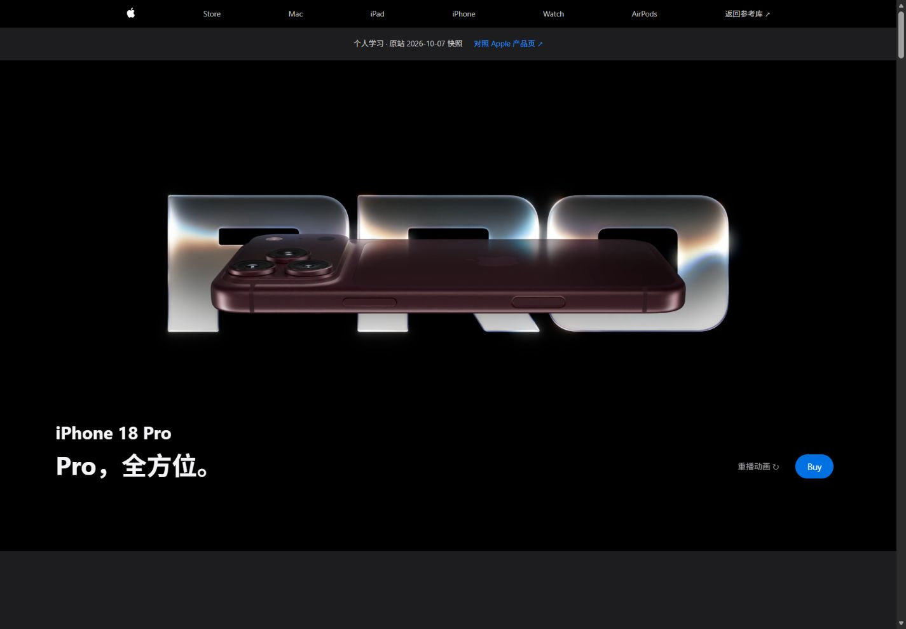</a> <strong>Apple · 滚动产品舞台</strong> 镜头系统真实视频随滚动逐帧推进；胶囊图库与进度。  <a href="../prompts/cases/apple-product.md">Prompt</a> · <a href="cases/apple-product.md">研究</a> · <a href="../demos/cases/apple-product">代码</a> · <a href="../previews/cases/apple-product-mobile.jpg">手机预览</a></td>
<td width="33%" valign="top"> <strong>Stripe — 彩带与金融产品矩阵</strong> SingleWave WebGL 波面、客户面板展开与手机二级导航。  <a href="../prompts/cases/stripe-platform.md">Prompt</a> · <a href="cases/stripe-platform.md">研究</a> · <a href="../demos/cases/stripe-platform">代码</a> · <a href="../previews/cases/stripe-platform-mobile.jpg">手机预览</a></td>
<td width="33%" valign="top"><a href="https://mibxr-design-atlas.mibxranime.chatgpt.site/cases.html#style/linear-workflow">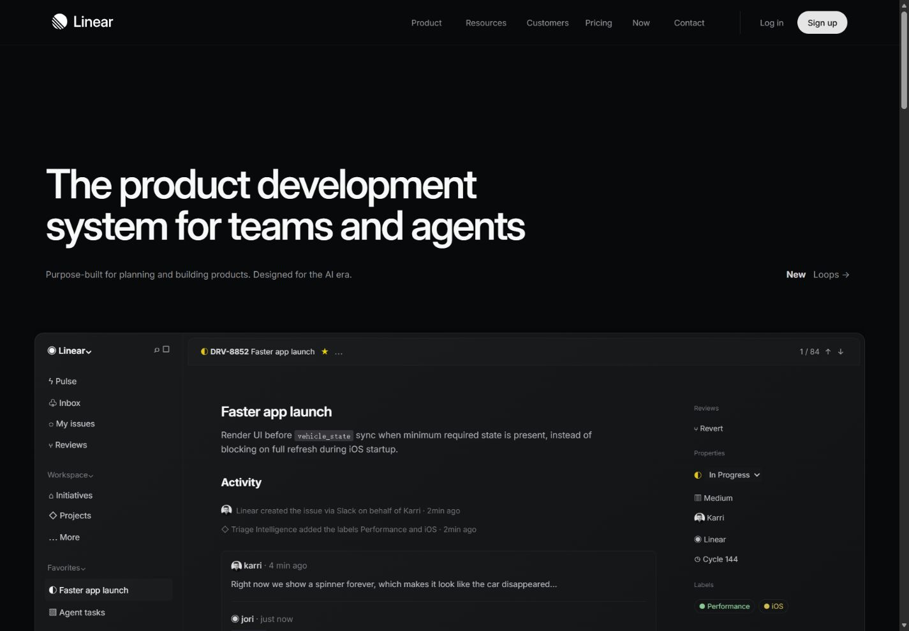</a> <strong>Linear — 深色产品开发系统</strong> 消息与任务卡接力、AI处理节拍、Build代码差异演示。  <a href="../prompts/cases/linear-workflow.md">Prompt</a> · <a href="cases/linear-workflow.md">研究</a> · <a href="../demos/cases/linear-workflow">代码</a> · <a href="../previews/cases/linear-workflow-mobile.jpg">手机预览</a></td>
</tr>
<tr>
<td width="33%" valign="top"><a href="https://mibxr-design-atlas.mibxranime.chatgpt.site/cases.html#style/notion-editorial">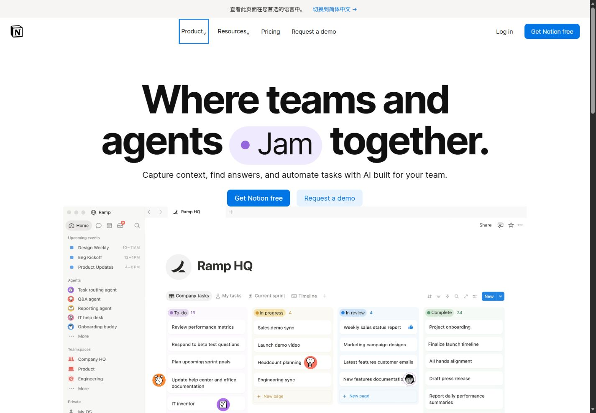</a> <strong>Notion — 插画与真实工作空间</strong> 动词与宽度轮换、真实产品视频与手机单开导航。  <a href="../prompts/cases/notion-editorial.md">Prompt</a> · <a href="cases/notion-editorial.md">研究</a> · <a href="../demos/cases/notion-editorial">代码</a> · <a href="../previews/cases/notion-editorial-mobile.jpg">手机预览</a></td>
<td width="33%" valign="top"><a href="https://mibxr-design-atlas.mibxranime.chatgpt.site/cases.html#style/chatgpt-platform">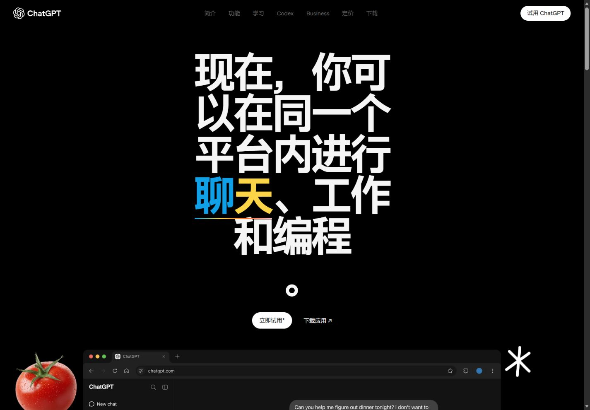</a> <strong>ChatGPT — 巨字、飞入拼贴与滚动交接</strong> 悬停模式、独立素材飞入飞出、同一窗口滚动交接。  <a href="../prompts/cases/chatgpt-platform.md">Prompt</a> · <a href="cases/chatgpt-platform.md">研究</a> · <a href="../demos/cases/chatgpt-platform">代码</a> · <a href="../previews/cases/chatgpt-platform-mobile.jpg">手机预览</a></td>
<td width="33%" valign="top"><a href="https://mibxr-design-atlas.mibxranime.chatgpt.site/cases.html#style/claude-platform">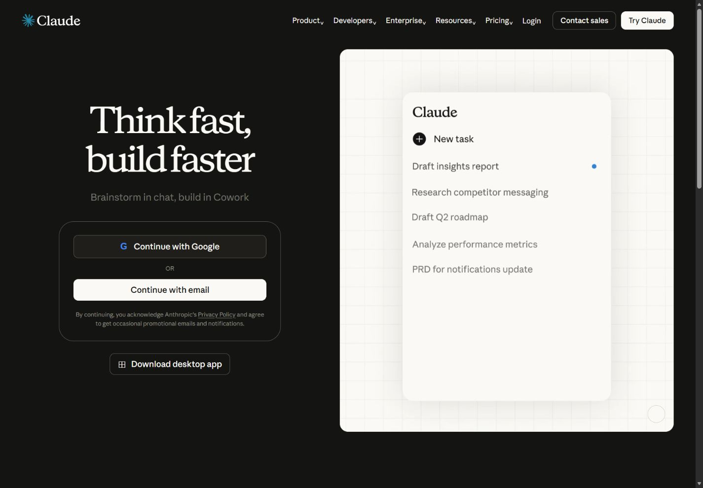</a> <strong>Claude — 衬线语气与 Cowork 演示</strong> 暖纸色、衬线巨字与真实媒体的克制叙事。  <a href="../prompts/cases/claude-platform.md">Prompt</a> · <a href="cases/claude-platform.md">研究</a> · <a href="../demos/cases/claude-platform">代码</a> · <a href="../previews/cases/claude-platform-mobile.jpg">手机预览</a></td>
</tr>
<tr>
<td width="33%" valign="top"><a href="https://mibxr-design-atlas.mibxranime.chatgpt.site/cases.html#style/qoder-platform">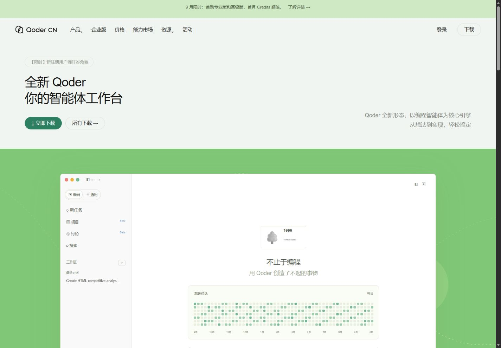</a> <strong>Qoder — 绿色工作台与多形态平台</strong> 无衬线巨字、产品内嵌预览、400ms横向平台切换。  <a href="../prompts/cases/qoder-platform.md">Prompt</a> · <a href="cases/qoder-platform.md">研究</a> · <a href="../demos/cases/qoder-platform">代码</a> · <a href="../previews/cases/qoder-platform-mobile.jpg">手机预览</a></td>
<td width="33%" valign="top"><a href="https://mibxr-design-atlas.mibxranime.chatgpt.site/cases.html#style/google-material">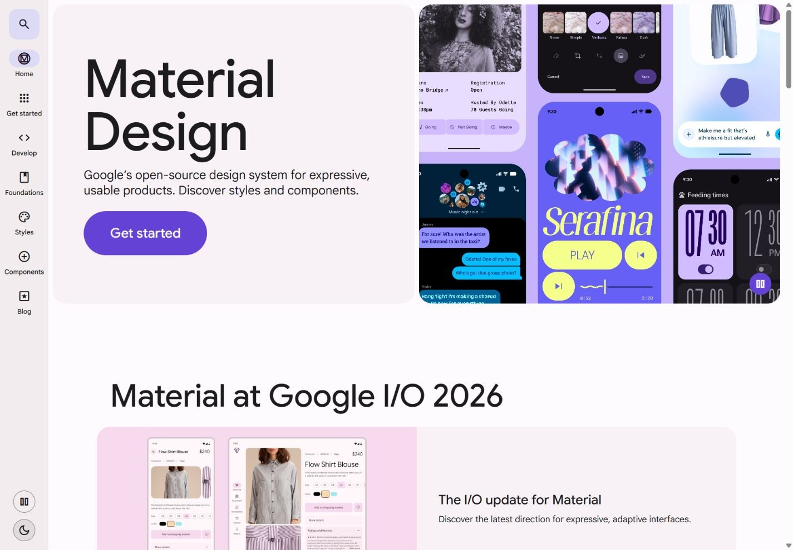</a> <strong>Google Material：表现力与组件秩序</strong> 系统与手动主题、300ms目录、9秒组件视频与圆角反馈。  <a href="../prompts/cases/google-material.md">Prompt</a> · <a href="cases/google-material.md">研究</a> · <a href="../demos/cases/google-material">代码</a> · <a href="../previews/cases/google-material-mobile.jpg">手机预览</a></td>
<td width="33%" valign="top"><a href="https://mibxr-design-atlas.mibxranime.chatgpt.site/cases.html#style/deepseek-harness">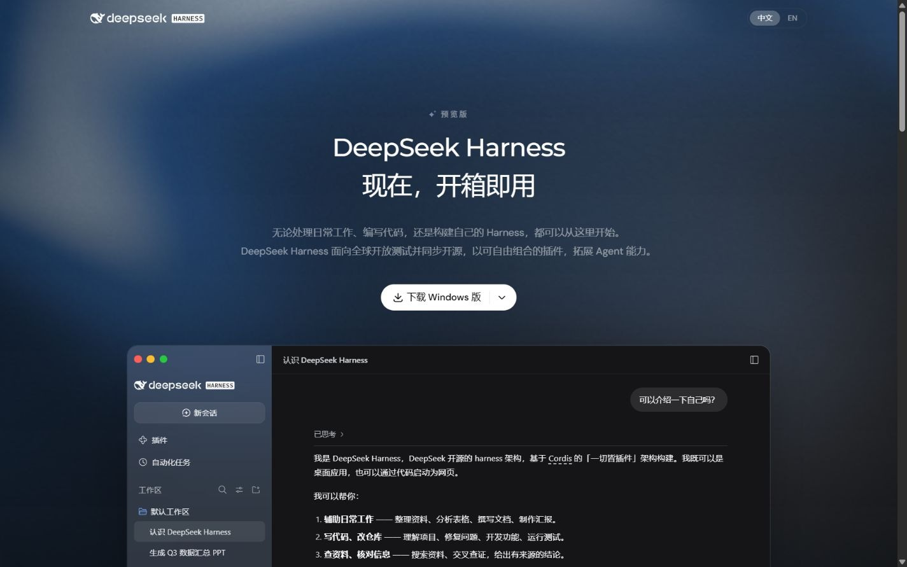</a> <strong>DeepSeek Harness · 可观察的产品演示</strong> 完整双语产品页、四组代码动效、流体与三维聚合页尾。  <a href="../prompts/cases/deepseek-harness.md">Prompt</a> · <a href="cases/deepseek-harness.md">研究</a> · <a href="../demos/cases/deepseek-harness">代码</a> · <a href="../previews/cases/deepseek-harness-mobile.jpg">手机预览</a></td>
</tr>
</table>

### 游戏与 IP · 10

角色、世界、音乐与切换节奏共同塑造品牌体验。

<table>
<tr>
<td width="33%" valign="top"><a href="https://mibxr-design-atlas.mibxranime.chatgpt.site/cases.html#style/zelda-world">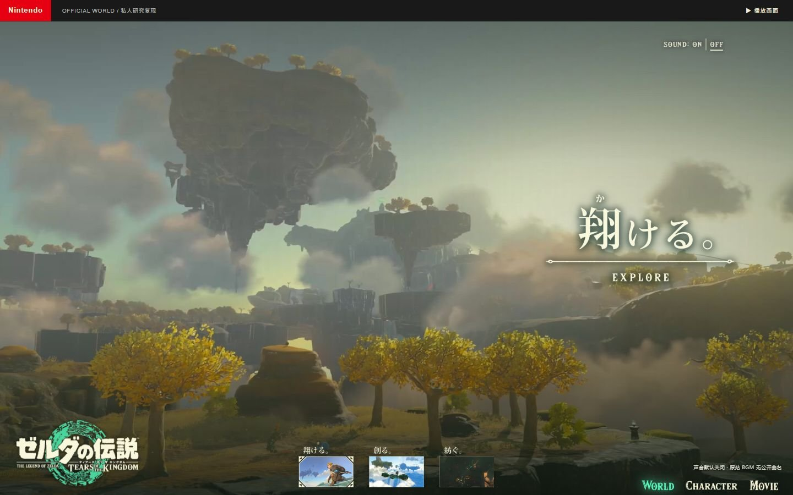</a> <strong>塞尔达 · 全景世界舞台</strong> 声音选择开场、古代纹样缩略图框、世界场景淡化与官方BGM。  <a href="../prompts/cases/zelda-world.md">Prompt</a> · <a href="cases/zelda-world.md">研究</a> · <a href="../demos/cases/zelda-world">代码</a> · <a href="../previews/cases/zelda-world-mobile.jpg">手机预览</a></td>
<td width="33%" valign="top"><a href="https://mibxr-design-atlas.mibxranime.chatgpt.site/cases.html#style/persona-kinetic">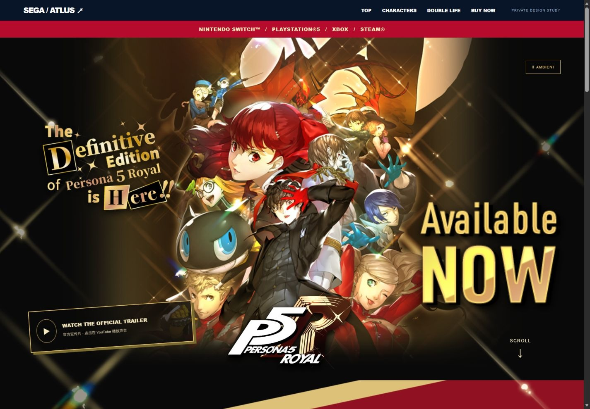</a> <strong>Persona 5 Royal · 黑金角色拼贴</strong> SCREEN 星纹呼吸、滚动视差、角色服装与两套独立滑轨。  <a href="../prompts/cases/persona-kinetic.md">Prompt</a> · <a href="cases/persona-kinetic.md">研究</a> · <a href="../demos/cases/persona-kinetic">代码</a> · <a href="../previews/cases/persona-kinetic-mobile.jpg">手机预览</a></td>
<td width="33%" valign="top"><a href="https://mibxr-design-atlas.mibxranime.chatgpt.site/cases.html#style/genshin-world">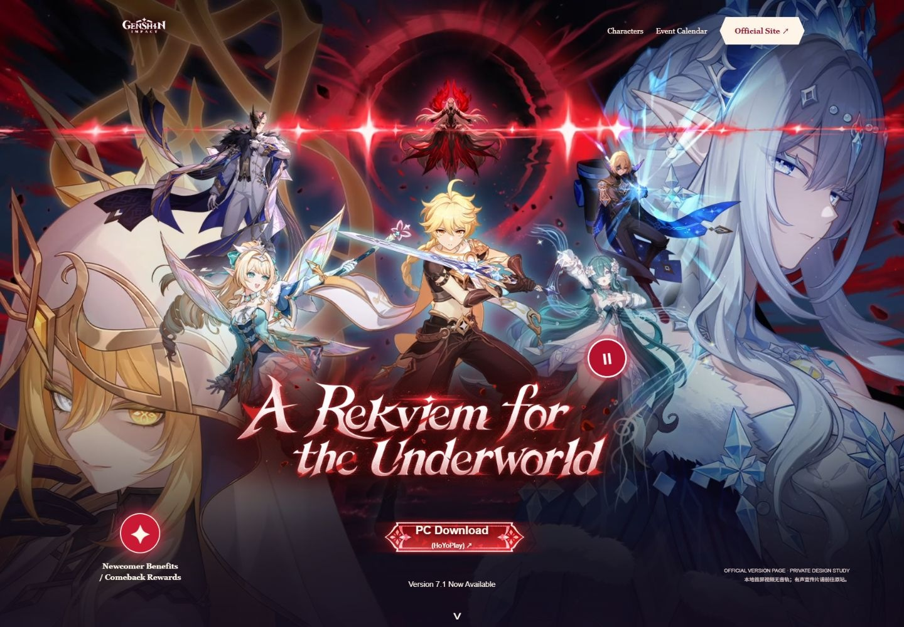</a> <strong>原神 · 版本群像与角色舞台</strong> 竖向整屏章切、角色背景联动与六条原始随机语音。  <a href="../prompts/cases/genshin-world.md">Prompt</a> · <a href="cases/genshin-world.md">研究</a> · <a href="../demos/cases/genshin-world">代码</a> · <a href="../previews/cases/genshin-world-mobile.jpg">手机预览</a></td>
</tr>
<tr>
<td width="33%" valign="top"><a href="https://mibxr-design-atlas.mibxranime.chatgpt.site/cases.html#style/arknights-world">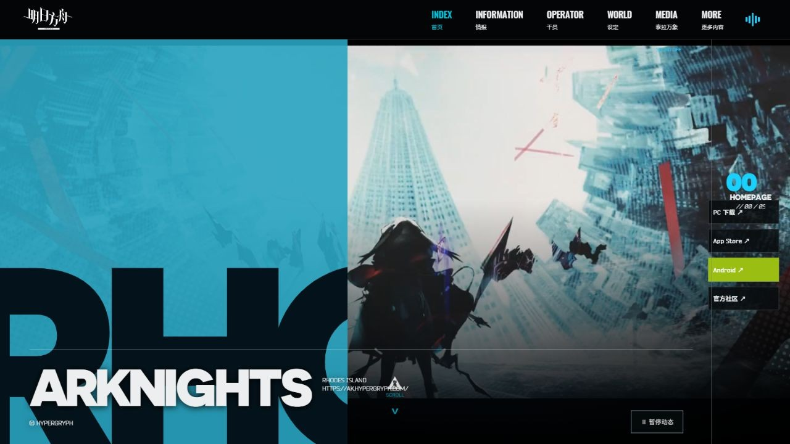</a> <strong>明日方舟 · 全屏档案与交互点阵</strong> 全屏载入、侧向遮罩与滚号、原站点阵互动和 BGM。  <a href="../prompts/cases/arknights-world.md">Prompt</a> · <a href="cases/arknights-world.md">研究</a> · <a href="../demos/cases/arknights-world">代码</a> · <a href="../previews/cases/arknights-world-mobile.jpg">手机预览</a></td>
<td width="33%" valign="top"><a href="https://mibxr-design-atlas.mibxranime.chatgpt.site/cases.html#style/uma-musume">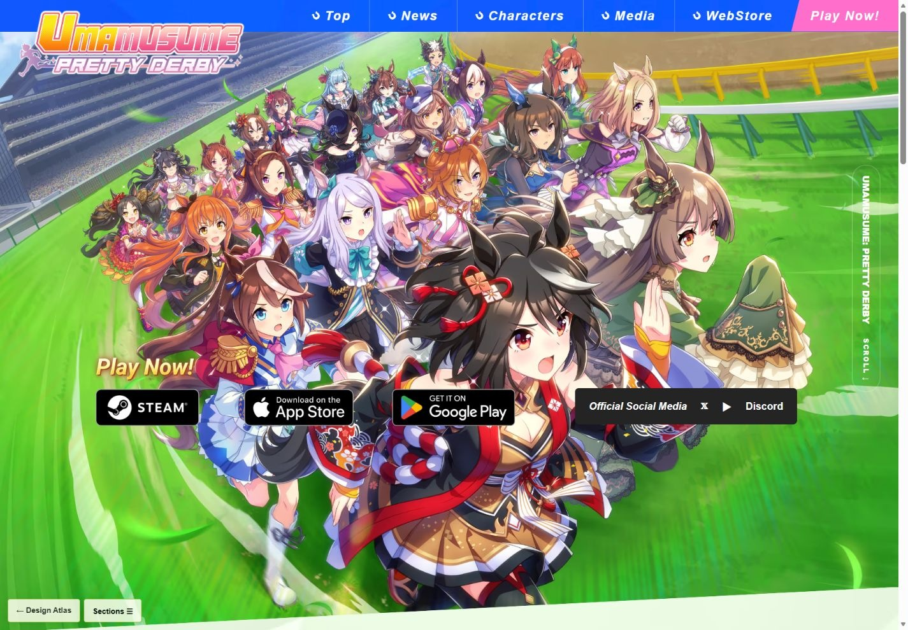</a> <strong>赛马娘：群像赛道与斜切叙事</strong> 马蹄菜单、Logo 滚动缩放、玩法轨道与无音轨 About 影片。  <a href="../prompts/cases/uma-musume.md">Prompt</a> · <a href="cases/uma-musume.md">研究</a> · <a href="../demos/cases/uma-musume">代码</a> · <a href="../previews/cases/uma-musume-mobile.jpg">手机预览</a></td>
<td width="33%" valign="top"><a href="https://mibxr-design-atlas.mibxranime.chatgpt.site/cases.html#style/blue-archive">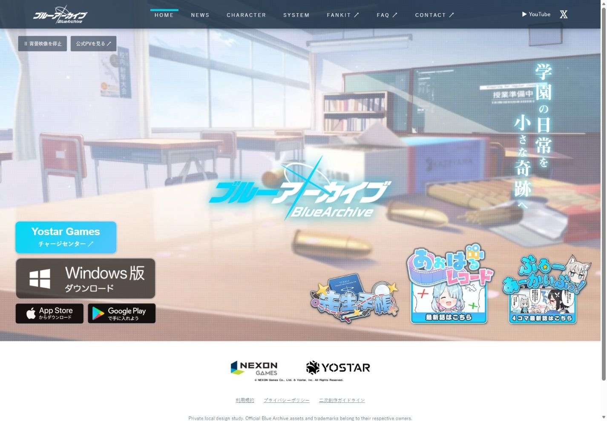</a> <strong>碧蓝档案：学园都市的天空与光</strong> 首页与角色独立页面、人物轨道与四条官方语音。  <a href="../prompts/cases/blue-archive.md">Prompt</a> · <a href="cases/blue-archive.md">研究</a> · <a href="../demos/cases/blue-archive">代码</a> · <a href="../previews/cases/blue-archive-mobile.jpg">手机预览</a></td>
</tr>
<tr>
<td width="33%" valign="top"><a href="https://mibxr-design-atlas.mibxranime.chatgpt.site/cases.html#style/monument-valley-game">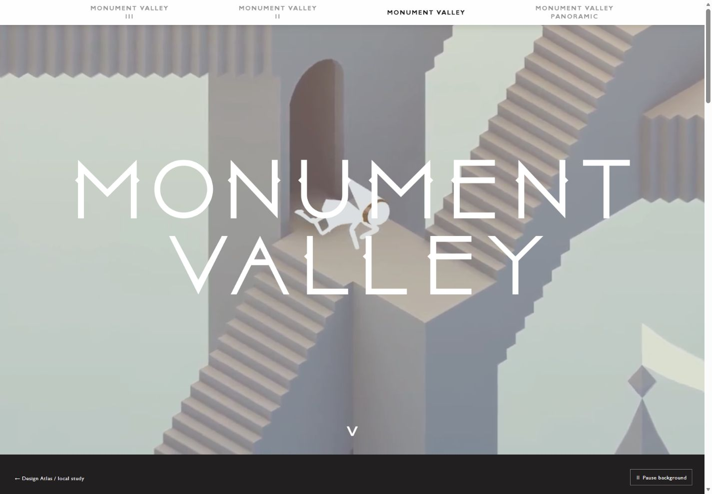</a> <strong>纪念碑谷：电影首入、奖项进入与中心画廊</strong> 一秒加载、奖项双向进出、手机展开与十四图居中循环。  <a href="../prompts/cases/monument-valley-game.md">Prompt</a> · <a href="cases/monument-valley-game.md">研究</a> · <a href="../demos/cases/monument-valley-game">代码</a> · <a href="../previews/cases/monument-valley-game-mobile.jpg">手机预览</a></td>
<td width="33%" valign="top"><a href="https://mibxr-design-atlas.mibxranime.chatgpt.site/cases.html#style/endfield-industrial">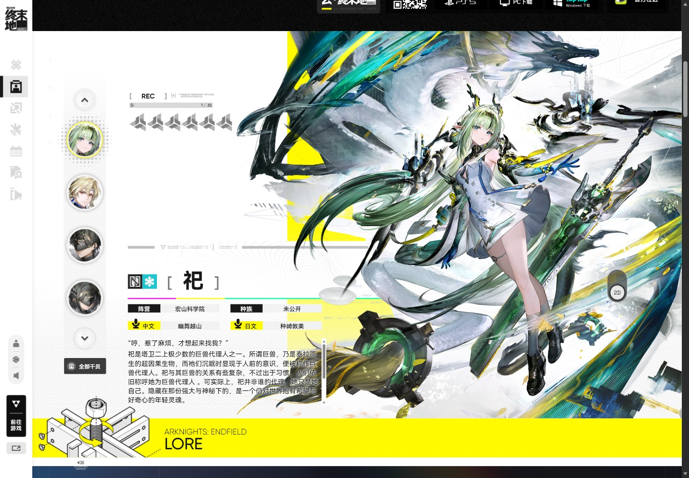</a> <strong>终末地 · 白底工业档案</strong> 八章官网研究：真实透明视频、点云射线与分层切换。  <a href="../prompts/cases/endfield-industrial.md">Prompt</a> · <a href="cases/endfield-industrial.md">研究</a> · <a href="../demos/cases/endfield-industrial">代码</a> · <a href="../previews/cases/endfield-industrial-mobile.jpg">手机预览</a></td>
<td width="33%" valign="top"><a href="https://mibxr-design-atlas.mibxranime.chatgpt.site/cases.html#style/rhine-lab">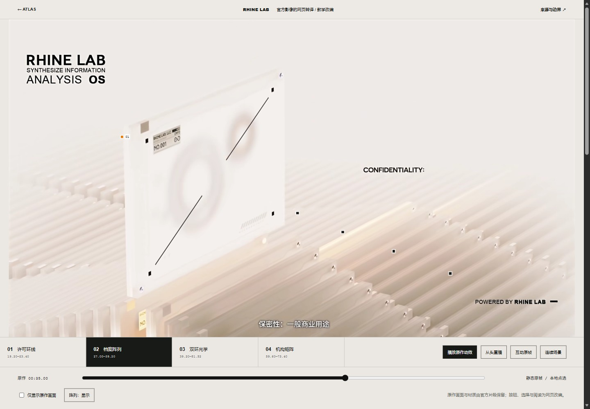</a> <strong>莱茵生命 · 官方影像的网页转译</strong> 官方影像网页转译：米白透明档案、科室缩写与橙色信号。  <a href="../prompts/cases/rhine-lab.md">Prompt</a> · <a href="cases/rhine-lab.md">研究</a> · <a href="../demos/cases/rhine-lab">代码</a> · <a href="../previews/cases/rhine-lab-mobile.jpg">手机预览</a></td>
</tr>
<tr>
<td width="33%" valign="top"><a href="https://mibxr-design-atlas.mibxranime.chatgpt.site/cases.html#style/zenless-zone-zero">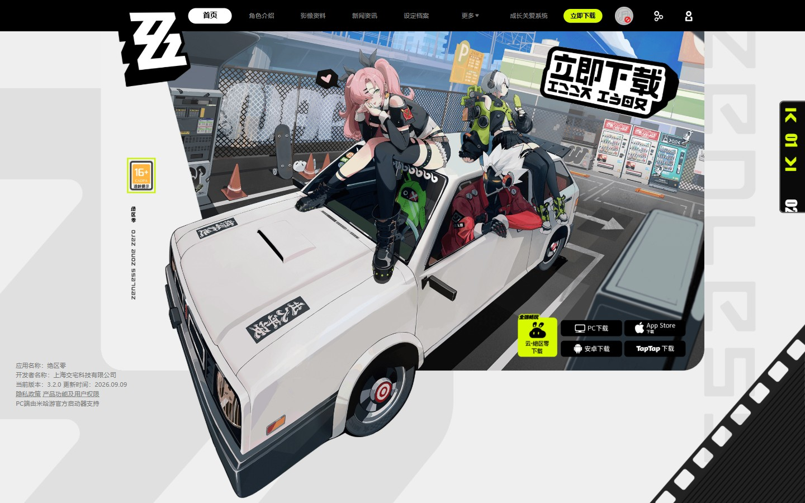</a> <strong>绝区零 · 六章街头拼贴首页</strong> 六章完整首页、62人角色舞台、9部影像与独立头像窗口。  <a href="../prompts/cases/zenless-zone-zero.md">Prompt</a> · <a href="cases/zenless-zone-zero.md">研究</a> · <a href="../demos/cases/zenless-zone-zero">代码</a> · <a href="../previews/cases/zenless-zone-zero-mobile.jpg">手机预览</a></td>
<td></td>
<td></td>
</tr>
</table>

### 艺术与文化 · 9

作品、海报、摄影与活动信息决定画面的主次关系；宫殿建筑、石窟壁画与江南空间也从具体文化内容中建立识别。

<table>
<tr>
<td width="33%" valign="top"><a href="https://mibxr-design-atlas.mibxranime.chatgpt.site/cases.html#style/design-sight">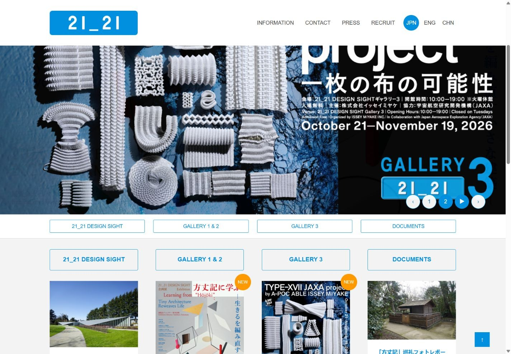</a> <strong>21_21 DESIGN SIGHT：海报与四列档案</strong> 海报主导、双图1000ms交叉淡化与信息分层。  <a href="../prompts/cases/design-sight.md">Prompt</a> · <a href="cases/design-sight.md">研究</a> · <a href="../demos/cases/design-sight">代码</a> · <a href="../previews/cases/design-sight-mobile.jpg">手机预览</a></td>
<td width="33%" valign="top"><a href="https://mibxr-design-atlas.mibxranime.chatgpt.site/cases.html#style/mori-art-museum">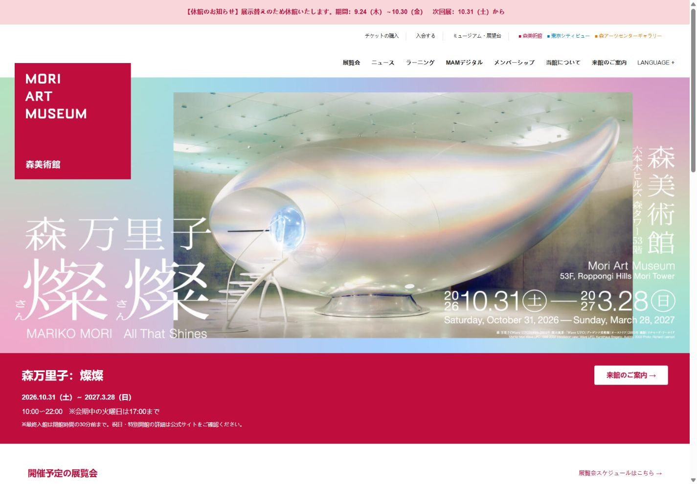</a> <strong>森美术馆：红色机构锚点与艺术海报</strong> 大馆标与海报、滚动紧凑红导航与手机侧移菜单。  <a href="../prompts/cases/mori-art-museum.md">Prompt</a> · <a href="cases/mori-art-museum.md">研究</a> · <a href="../demos/cases/mori-art-museum">代码</a> · <a href="../previews/cases/mori-art-museum-mobile.jpg">手机预览</a></td>
<td width="33%" valign="top"><a href="https://mibxr-design-atlas.mibxranime.chatgpt.site/cases.html#style/fuji-rock">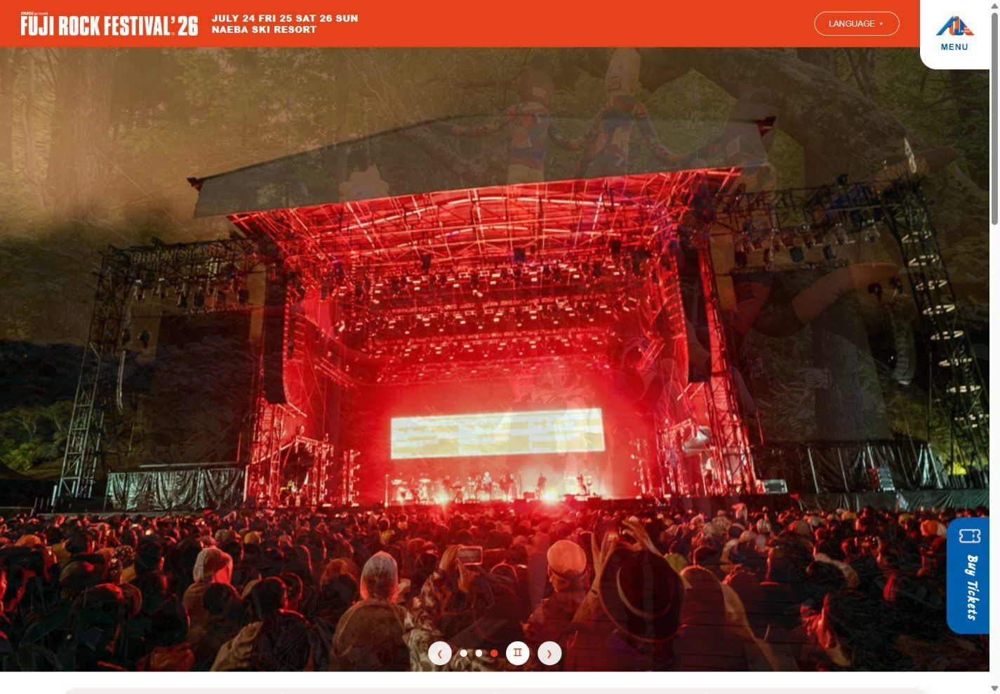</a> <strong>Fuji Rock：现场照片与节日导览</strong> 年度海报、800ms淡化轮播与展开式大菜单。  <a href="../prompts/cases/fuji-rock.md">Prompt</a> · <a href="cases/fuji-rock.md">研究</a> · <a href="../demos/cases/fuji-rock">代码</a> · <a href="../previews/cases/fuji-rock-mobile.jpg">手机预览</a></td>
</tr>
<tr>
<td width="33%" valign="top"><a href="https://mibxr-design-atlas.mibxranime.chatgpt.site/cases.html#style/rijksmuseum-art">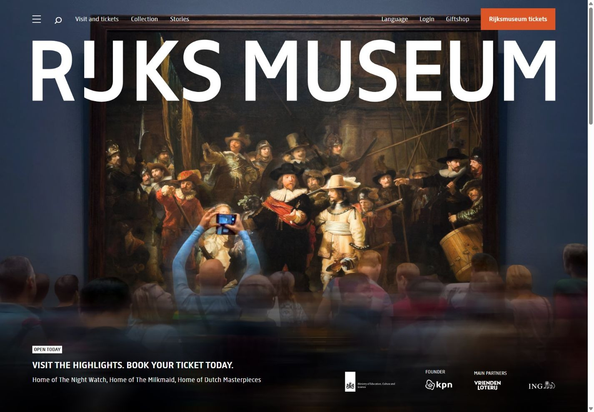</a> <strong>Rijksmuseum · 全幅摄影与巨大字标</strong> 摄影原生浏览、巨大字标与全屏菜单淡化。  <a href="../prompts/cases/rijksmuseum-art.md">Prompt</a> · <a href="cases/rijksmuseum-art.md">研究</a> · <a href="../demos/cases/rijksmuseum-art">代码</a> · <a href="../previews/cases/rijksmuseum-art-mobile.jpg">手机预览</a></td>
<td width="33%" valign="top"><a href="https://mibxr-design-atlas.mibxranime.chatgpt.site/cases.html#style/met-museum">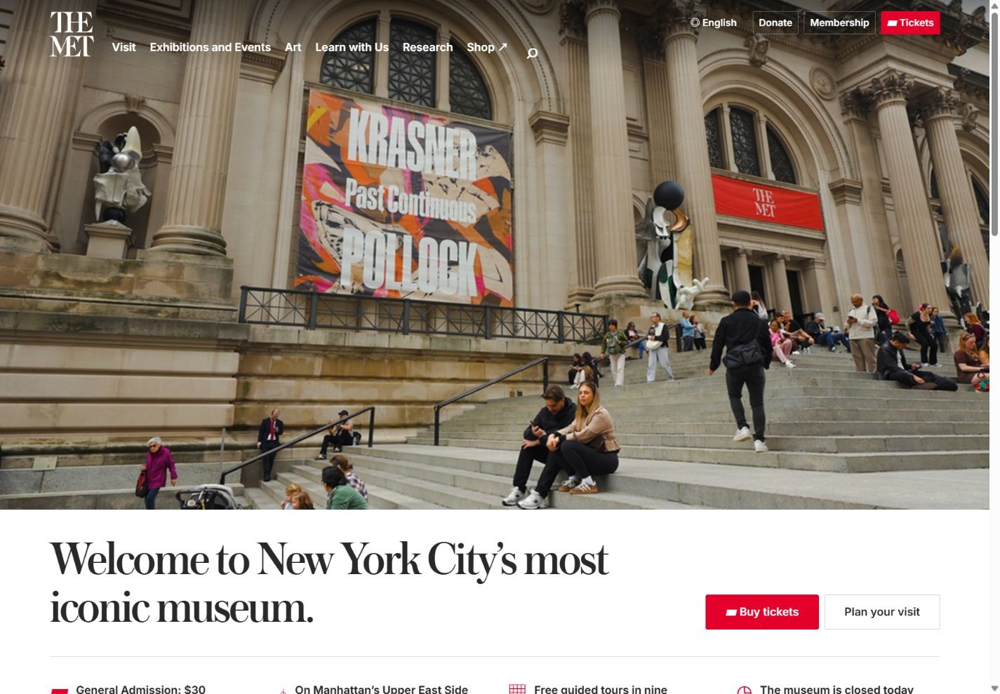</a> <strong>The Met · 编辑式展览与馆藏陈列</strong> 官方建筑摄影、编辑标题、原生展览横架与原地展开菜单。  <a href="../prompts/cases/met-museum.md">Prompt</a> · <a href="cases/met-museum.md">研究</a> · <a href="../demos/cases/met-museum">代码</a> · <a href="../previews/cases/met-museum-mobile.jpg">手机预览</a></td>
<td width="33%" valign="top"><a href="https://mibxr-design-atlas.mibxranime.chatgpt.site/cases.html#style/philharmonie-music">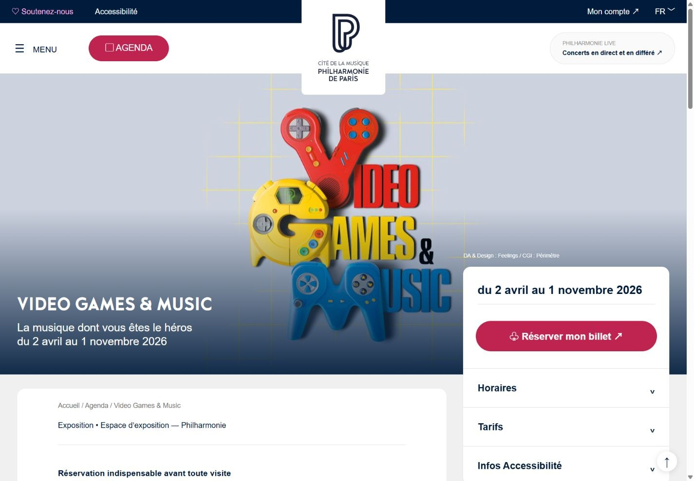</a> <strong>巴黎爱乐厅 · 音乐展与音乐会详情</strong> 桌面固定票务、音乐会循环摄影与官方歌单。  <a href="../prompts/cases/philharmonie-music.md">Prompt</a> · <a href="cases/philharmonie-music.md">研究</a> · <a href="../demos/cases/philharmonie-music">代码</a> · <a href="../previews/cases/philharmonie-music-mobile.jpg">手机预览</a></td>
</tr>
<tr>
<td width="33%" valign="top"><a href="https://mibxr-design-atlas.mibxranime.chatgpt.site/cases.html#style/palace-museum">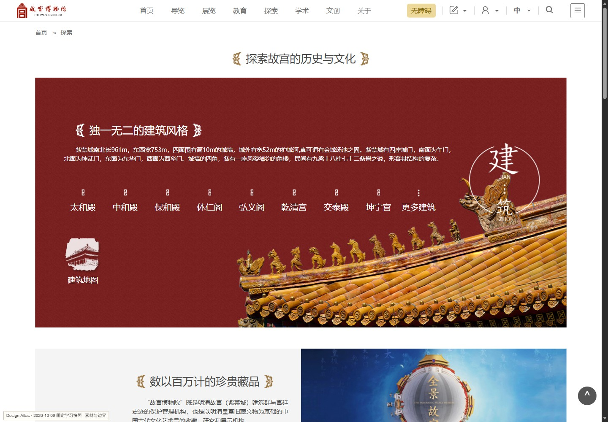</a> <strong>故宫 · 朱红建筑锚点与纸签目录</strong> 真实屋脊锚定朱红章节，图像与半幅纸签分工。  <a href="../prompts/cases/palace-museum.md">Prompt</a> · <a href="cases/palace-museum.md">研究</a> · <a href="../demos/cases/palace-museum">代码</a> · <a href="../previews/cases/palace-museum-mobile.jpg">手机预览</a></td>
<td width="33%" valign="top"><a href="https://mibxr-design-atlas.mibxranime.chatgpt.site/cases.html#style/digital-dunhuang">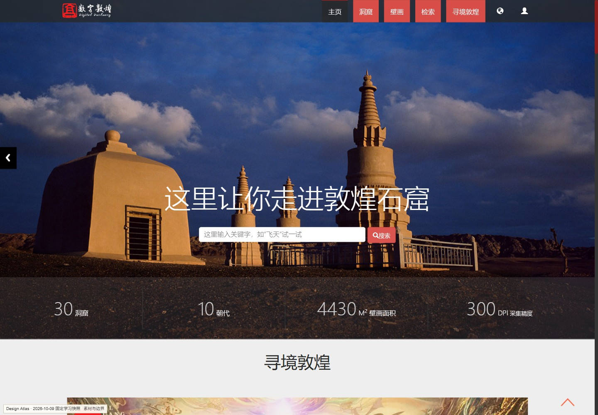</a> <strong>数字敦煌 · 影像检索与壁画细察</strong> 原站发现、条件目录与公开壁画 Deep Zoom 三页流程。  <a href="../prompts/cases/digital-dunhuang.md">Prompt</a> · <a href="cases/digital-dunhuang.md">研究</a> · <a href="../demos/cases/digital-dunhuang">代码</a> · <a href="../previews/cases/digital-dunhuang-mobile.jpg">手机预览</a></td>
<td width="33%" valign="top"><a href="https://mibxr-design-atlas.mibxranime.chatgpt.site/cases.html#style/suzhou-museum">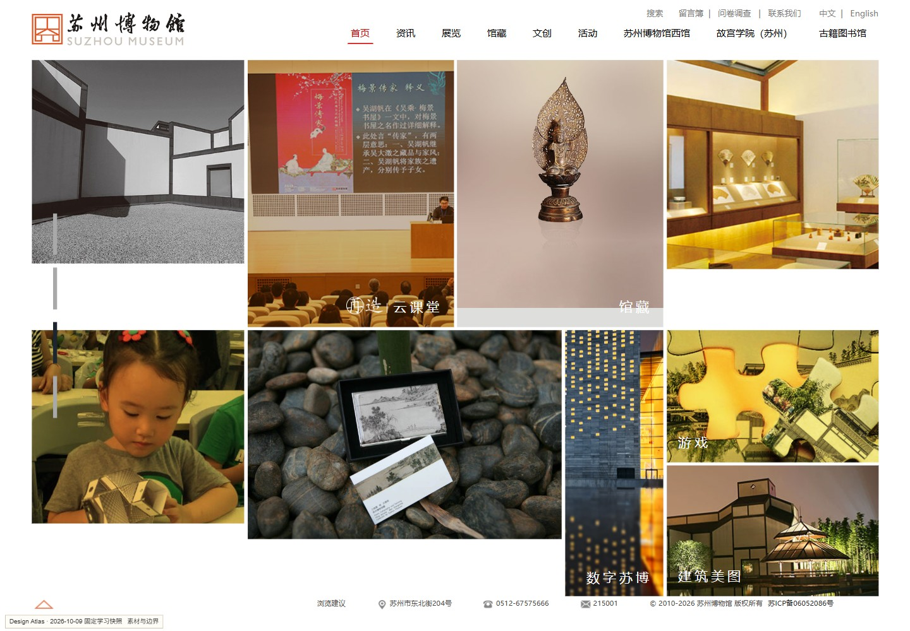</a> <strong>苏州博物馆 · 图像目的地与江南留白</strong> 多尺度图像目的地，粉墙黛色与建筑到访章节。  <a href="../prompts/cases/suzhou-museum.md">Prompt</a> · <a href="cases/suzhou-museum.md">研究</a> · <a href="../demos/cases/suzhou-museum">代码</a> · <a href="../previews/cases/suzhou-museum-mobile.jpg">手机预览</a></td>
</tr>
</table>

### 经典设计语言 · 8

理解构成规则和约束，再将其迁移到新的内容。

<table>
<tr>
<td width="33%" valign="top"><a href="https://mibxr-design-atlas.mibxranime.chatgpt.site/cases.html#style/hand-drawn">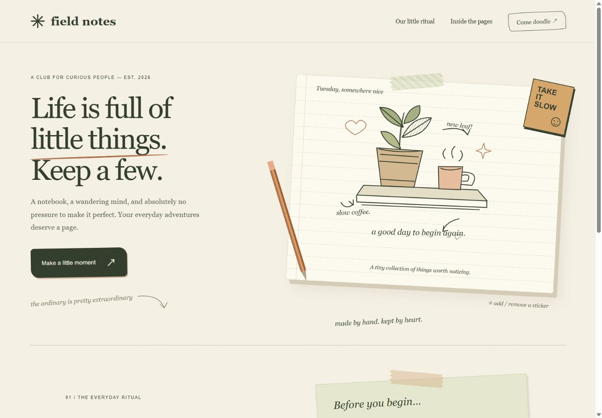</a> <strong>手绘：把不完美变成亲近感</strong> 不完全直线、纸面质感和亲近的图文关系。  <a href="../prompts/cases/hand-drawn.md">Prompt</a> · <a href="cases/hand-drawn.md">研究</a> · <a href="../demos/cases/hand-drawn">代码</a> · <a href="../previews/cases/hand-drawn-mobile.jpg">手机预览</a></td>
<td width="33%" valign="top"><a href="https://mibxr-design-atlas.mibxranime.chatgpt.site/cases.html#style/isometric-3d">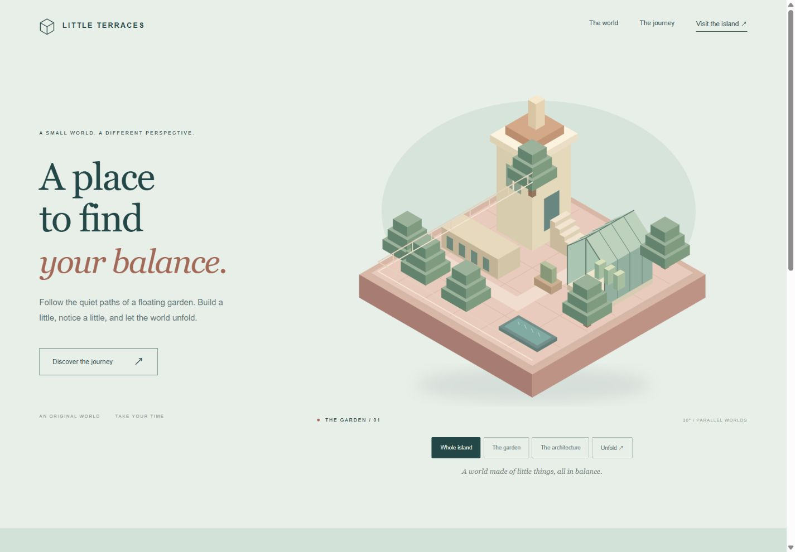</a> <strong>等轴 3D：让空间讲述系统</strong> 统一投影、空间层次和部件的结构关联。  <a href="../prompts/cases/isometric-3d.md">Prompt</a> · <a href="cases/isometric-3d.md">研究</a> · <a href="../demos/cases/isometric-3d">代码</a> · <a href="../previews/cases/isometric-3d-mobile.jpg">手机预览</a></td>
<td width="33%" valign="top"><a href="https://mibxr-design-atlas.mibxranime.chatgpt.site/cases.html#style/line-art">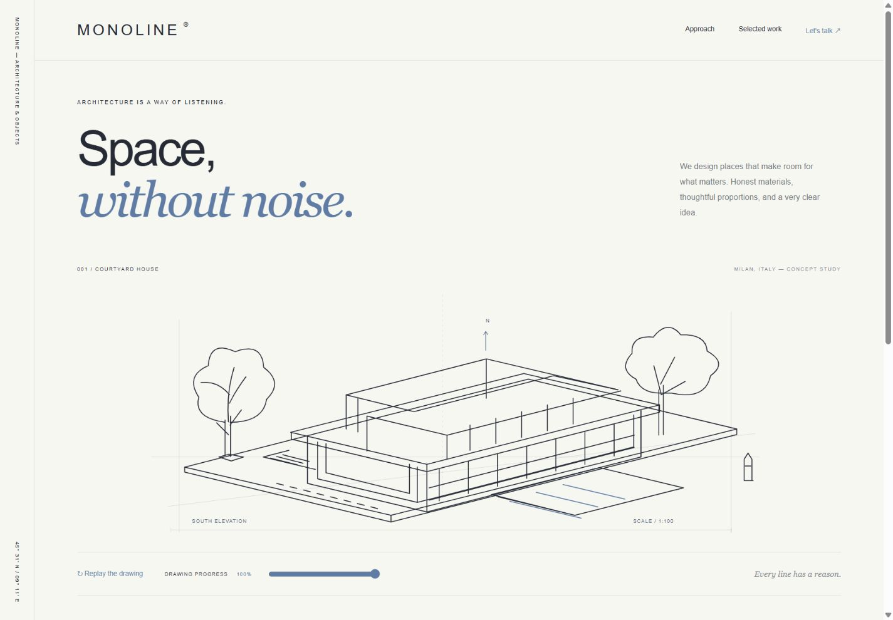</a> <strong>线条：沿绘制顺序解释结构</strong> 单一线宽、描边绘制顺序和轻量留白。  <a href="../prompts/cases/line-art.md">Prompt</a> · <a href="cases/line-art.md">研究</a> · <a href="../demos/cases/line-art">代码</a> · <a href="../previews/cases/line-art-mobile.jpg">手机预览</a></td>
</tr>
<tr>
<td width="33%" valign="top"><a href="https://mibxr-design-atlas.mibxranime.chatgpt.site/cases.html#style/shape-morph">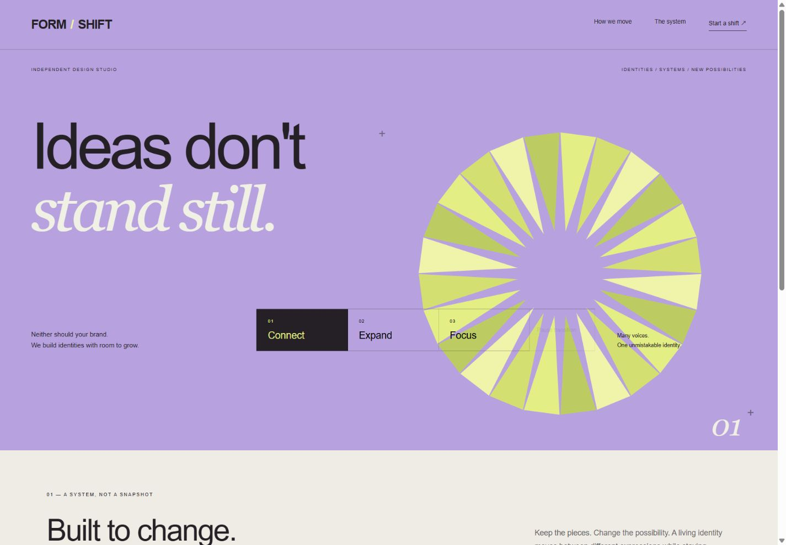</a> <strong>动态形状：同一单元，多种表达</strong> 拓扑可兼容的形状变化与连续状态反馈。  <a href="../prompts/cases/shape-morph.md">Prompt</a> · <a href="cases/shape-morph.md">研究</a> · <a href="../demos/cases/shape-morph">代码</a> · <a href="../previews/cases/shape-morph-mobile.jpg">手机预览</a></td>
<td width="33%" valign="top"><a href="https://mibxr-design-atlas.mibxranime.chatgpt.site/cases.html#style/swiss-grid">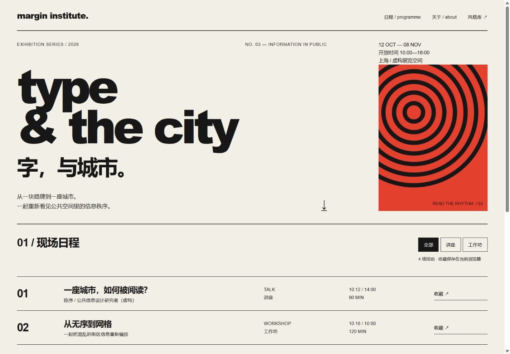</a> <strong>瑞士设计：编辑网格</strong> 强网格、无衬线尺度和清晰编辑层级。  <a href="../prompts/cases/swiss-grid.md">Prompt</a> · <a href="cases/swiss-grid.md">研究</a> · <a href="../demos/cases/swiss-grid">代码</a> · <a href="../previews/cases/swiss-grid-mobile.jpg">手机预览</a></td>
<td width="33%" valign="top"><a href="https://mibxr-design-atlas.mibxranime.chatgpt.site/cases.html#style/bauhaus-geometry">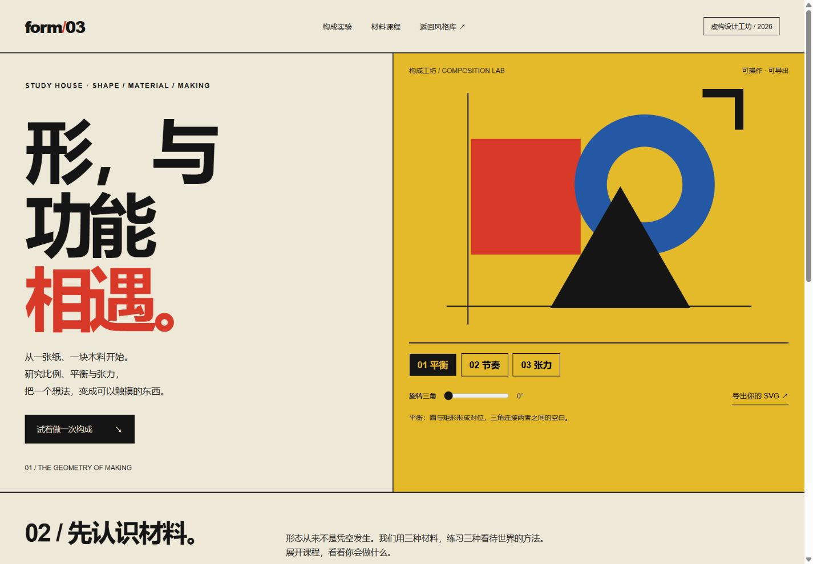</a> <strong>包豪斯：几何与实验</strong> 基本几何、有限色盘和均衡的非对称构成。  <a href="../prompts/cases/bauhaus-geometry.md">Prompt</a> · <a href="cases/bauhaus-geometry.md">研究</a> · <a href="../demos/cases/bauhaus-geometry">代码</a> · <a href="../previews/cases/bauhaus-geometry-mobile.jpg">手机预览</a></td>
</tr>
<tr>
<td width="33%" valign="top"><a href="https://mibxr-design-atlas.mibxranime.chatgpt.site/cases.html#style/retro-80s">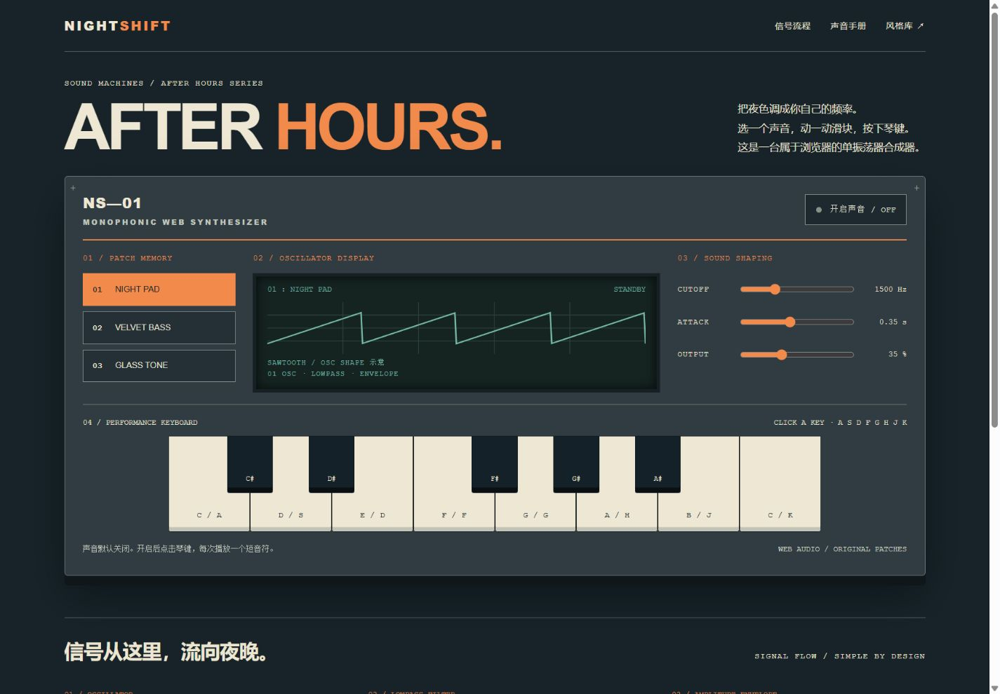</a> <strong>80年代：合成器面板</strong> 复古硬件面板、音色预设与实时短音符反馈。  <a href="../prompts/cases/retro-80s.md">Prompt</a> · <a href="cases/retro-80s.md">研究</a> · <a href="../demos/cases/retro-80s">代码</a> · <a href="../previews/cases/retro-80s-mobile.jpg">手机预览</a></td>
<td width="33%" valign="top"><a href="https://mibxr-design-atlas.mibxranime.chatgpt.site/cases.html#style/pixel-world">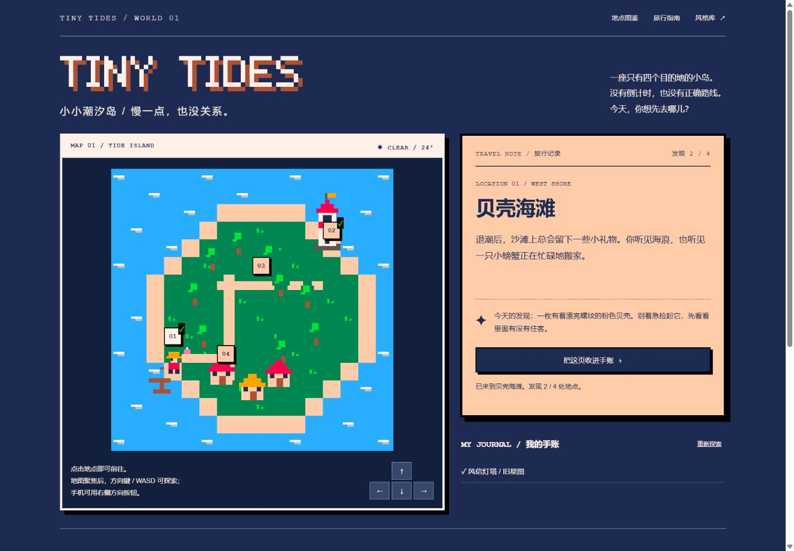</a> <strong>像素：微型世界</strong> 整数像素网格、地点移动与可保存的旅行手账。  <a href="../prompts/cases/pixel-world.md">Prompt</a> · <a href="cases/pixel-world.md">研究</a> · <a href="../demos/cases/pixel-world">代码</a> · <a href="../previews/cases/pixel-world-mobile.jpg">手机预览</a></td>
<td></td>
</tr>
</table>

### 示范作品 · 2

公开技能仓库中的完整示范页，保留原文与设计，只将外链资源本地化；研究页面机制及明确存在的基线，页面设定作为示范内容。

<table>
<tr>
<td width="33%" valign="top"><a href="https://mibxr-design-atlas.mibxranime.chatgpt.site/cases.html#style/stellar-museum">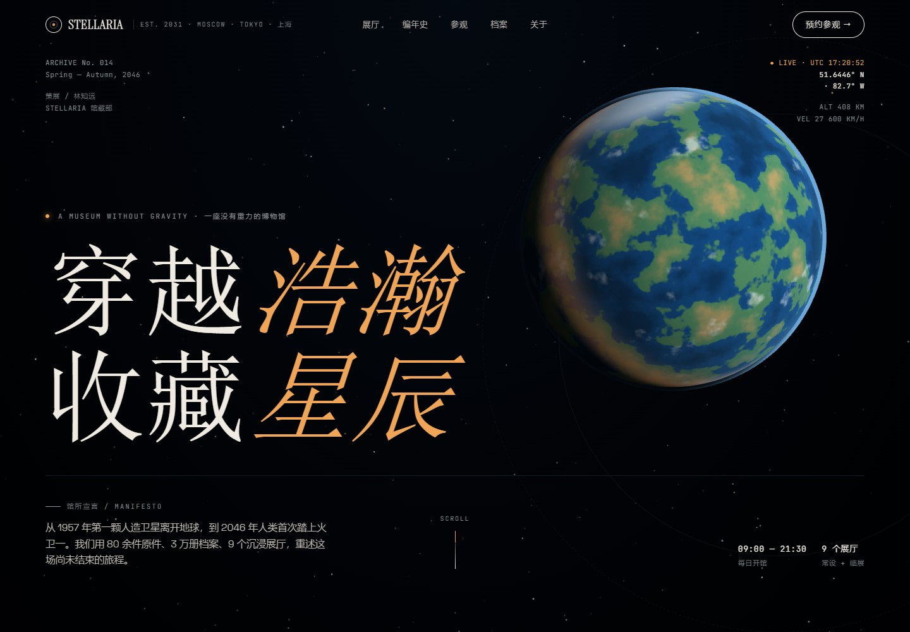</a> <strong>星槎 STELLAR · 太空探索博物馆</strong> 编辑式长页、程序化三维展厅及未使用技能的基线对照。  <a href="../prompts/cases/stellar-museum.md">Prompt</a> · <a href="cases/stellar-museum.md">研究</a> · <a href="../demos/cases/stellar-museum">代码</a> · <a href="../previews/cases/stellar-museum-mobile.jpg">手机预览</a></td>
<td width="33%" valign="top"><a href="https://mibxr-design-atlas.mibxranime.chatgpt.site/cases.html#style/mira-host-photography">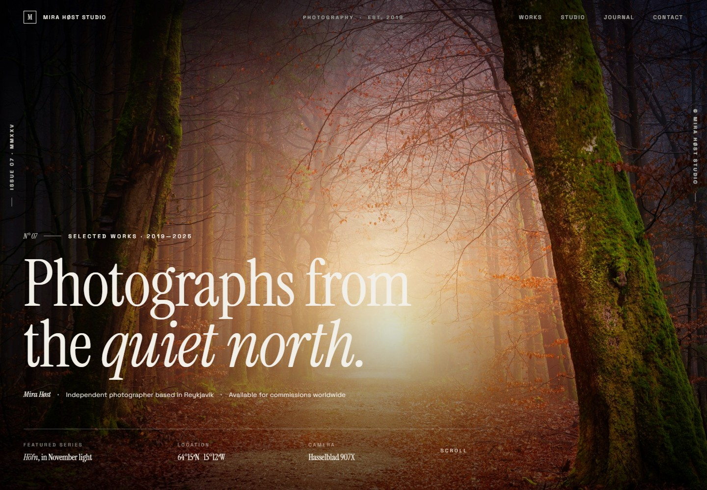</a> <strong>Mira Høst · 北欧摄影作品集</strong> 全幅摄影、衬线斜体、非对称图组与目录悬停预览。  <a href="../prompts/cases/mira-host-photography.md">Prompt</a> · <a href="cases/mira-host-photography.md">研究</a> · <a href="../demos/cases/mira-host-photography">代码</a> · <a href="../previews/cases/mira-host-photography-mobile.jpg">手机预览</a></td>
</tr>
</table>
